# Modelos de clasificación para el mercado bursátil — Laboratorio 12 (Minería de Datos)

[](https://creativecommons.org/licenses/by/4.0/)


**ES** · Cinco notebooks de Python, ya ejecutados, que recorren la clasificación aplicada a datos reales de la bolsa (Yahoo Finance): desde la matriz de confusión hasta un **sistema de recomendaciones** (COMPRAR / MANTENER / EVITAR) con *walk-forward*, costos de transacción y tablero web. Cada notebook sigue las fases de CRISP-DM, fija la semilla 2026 y compara cada modelo con una **referencia ingenua** (tasa base, «nunca avisar», 1/N o carteras al azar) antes de afirmar que «funciona».

**EN** · Five executed Python notebooks that walk through classification on real stock-market data (Yahoo Finance): from the confusion matrix to a **recommendation system** (BUY / HOLD / AVOID) with walk-forward validation, transaction costs and a web dashboard. Every notebook follows CRISP-DM, uses seed 2026 and benchmarks each model against a **naive baseline** (base rate, "never alert", 1/N or random portfolios).

Material elaborado para el curso de Minería de Datos de la FISI-UNMSM (semestre 2026-II, Tema 13: Modelos de Clasificación), por Ernesto D. Cancho-Rodríguez. Continúa el [Laboratorio 11 (regresión)](https://github.com/mbaernestocr-tech/regresion-bursatil-dm-lab11) con los mismos activos y la misma foto de datos ampliada hasta el 19-nov-2026.

## Contenido

- [Resultados en una mirada](#resultados-en-una-mirada)
- [Notebooks](#notebooks)
- [Figuras destacadas](#figuras-destacadas)
- [Datos de respaldo](#datos-de-respaldo)
- [Tablero y servidor](#tablero-y-servidor-tablero)
- [Diagramas UML](#diagramas-uml-diagramas-y-diagramas_misiones)
- [Scripts del trabajo grupal](#scripts-del-trabajo-grupal-scripts_grupales)
- [Cómo ejecutarlos](#cómo-ejecutarlos)
- [Entorno](#entorno-con-el-que-se-ejecutaron)
- [Estructura del repositorio](#estructura-del-repositorio)
- [Alcance y advertencias](#alcance-y-advertencias)
- [Cómo citar y licencia](#cómo-citar-y-licencia)

## Resultados en una mirada

Los notebooks contrastan **tres mundos** con el mismo código: el **Mundo 1** (ruido financiero: ¿sube SPY dentro de 5 sesiones?), el **Mundo 2** (datos sintéticos con estructura plantada) y el **Mundo 3** (datos reales con señal: ¿será agitado el próximo mes?). Las cifras siguientes salen de la ejecución de los notebooks (SPY, prueba desde el 9-may-2022; precios hasta el cierre del 19-nov-2026).

| Pregunta | Resultado | Referencia ingenua | Lectura |
|---|---|---|---|
| ¿Sube SPY dentro de 5 sesiones? (Mundo 1) | AUC **0,497**, valor p de permutación 0,56 | Tasa base 0,601 (exactitud de «siempre sube») | Indistinguible del azar: ningún modelo (logística, Naive Bayes, SVM, ensambles) crea señal |
| ¿Será agitado el próximo mes? (Mundo 3) | AUC **0,833** (logística), 0,840 (mejor ensamble) | Tasa base 0,353 | El riesgo sí se anticipa; la ventaja de un ensamble es de 0,009 |
| ¿Caída de 4 % o más en 10 sesiones? (Mundo 3, evento raro) | AUC 0,69, AUC-PR **0,19** | Tasa base 0,103 (AUC-PR del azar) | Señal modesta (≈ 1,9 veces el azar); con costos FN = 10·FP el umbral 0,07 baja el costo de 1 150 a **842** |
| ¿SMOTE antes de dividir ayuda? (Mundo 2) | AUC **0,998** frente a **0,733** dentro del pipeline | AUC sin remuestreo 0,708 | La fuga fabrica la métrica |
| ¿Naive Bayes con variables duplicadas? (Mundo 2) | Log-loss de 0,498 a **1,688** con 10 copias | Logística: 0,499 | Ordena casi igual, pero la probabilidad se rompe |
| ¿Quién supera a la mediana del portafolio? (Mundo 1) | AUC de ranking **0,50** en 227 rebalanceos | Tasa base 0,50 | La selección semanal de activos no se distingue del azar |
| ¿Sirve la cartera top-3 con costos de 10 pb? | **13,78 %** anual, Sharpe 0,68 | 1/N: 24,64 % y 1,09; SPY: 16,86 % y 1,04 | Percentil **53** frente a 1 000 carteras al azar: sin habilidad demostrable |
| Semáforo de mercado al 19-nov-2026 | VIX 28,44; P(alta volatilidad) **0,906**; P(caída ≥ 4 %) 0,204 | Tasas base históricas 0,30 y 0,097 | Mensaje honesto: el mercado está agitado; no hay evidencia de que rotar acciones aporte |

## Notebooks

| # | Notebook | Pregunta que responde | Técnicas | Colab |
|---|---|---|---|---|
| 1 | [`26.11.20.Lab12-G1_Clasificacion_ejecutado.ipynb`](notebooks/26.11.20.Lab12-G1_Clasificacion_ejecutado.ipynb) | ¿Cómo se mide un clasificador y por qué la exactitud engaña con eventos raros? | Matriz de confusión, precisión, exhaustividad, F1, ROC, AUC-PR, prueba de permutación, umbral por costos | [Abrir](https://colab.research.google.com/github/mbaernestocr-tech/clasificacion-bursatil-dm-lab12/blob/main/notebooks/26.11.20.Lab12-G1_Clasificacion_ejecutado.ipynb) |
| 2 | [`26.11.20.Lab12-G2_Clasificacion_ejecutado.ipynb`](notebooks/26.11.20.Lab12-G2_Clasificacion_ejecutado.ipynb) | ¿Cuándo funcionan Naive Bayes y la SVM y cuándo fallan? | Teorema de Bayes, variables duplicadas, kernel RBF, escala, C y gamma, calibración | [Abrir](https://colab.research.google.com/github/mbaernestocr-tech/clasificacion-bursatil-dm-lab12/blob/main/notebooks/26.11.20.Lab12-G2_Clasificacion_ejecutado.ipynb) |
| 3 | [`26.11.20.Lab12-G3_Clasificacion_ejecutado.ipynb`](notebooks/26.11.20.Lab12-G3_Clasificacion_ejecutado.ipynb) | ¿Cuánto ganan los ensambles de árboles y cuándo memorizan ruido? | Random Forest, Gradient Boosting, XGBoost, LightGBM, curva de validación, early stopping, importancia por permutación | [Abrir](https://colab.research.google.com/github/mbaernestocr-tech/clasificacion-bursatil-dm-lab12/blob/main/notebooks/26.11.20.Lab12-G3_Clasificacion_ejecutado.ipynb) |
| 4 | [`26.11.20.Lab12-G4_Clasificacion_ejecutado.ipynb`](notebooks/26.11.20.Lab12-G4_Clasificacion_ejecutado.ipynb) | ¿Cómo se construye una alerta de caída extrema y a qué umbral se avisa? | Desbalance, pesos por clase, SMOTE dentro del pipeline, calibración, umbral por costos, lift por activo | [Abrir](https://colab.research.google.com/github/mbaernestocr-tech/clasificacion-bursatil-dm-lab12/blob/main/notebooks/26.11.20.Lab12-G4_Clasificacion_ejecutado.ipynb) |
| 5 | [`26.11.20.Lab12-G5_Clasificacion_ejecutado.ipynb`](notebooks/26.11.20.Lab12-G5_Clasificacion_ejecutado.ipynb) | ¿Qué comprar, mantener o evitar este viernes, y se distingue del azar? | Panel (fecha, activo), objetivo relativo, walk-forward con embargo, cartera top-3 con costos, 1/N, SPY y carteras al azar, semáforo, JSON para el tablero | [Abrir](https://colab.research.google.com/github/mbaernestocr-tech/clasificacion-bursatil-dm-lab12/blob/main/notebooks/26.11.20.Lab12-G5_Clasificacion_ejecutado.ipynb) |

Los notebooks de las guías 2 a 5 construyen sobre los anteriores: la progresión va de la métrica al sistema completo. En Colab instale primero lo que falte: `!pip install xgboost lightgbm yfinance imbalanced-learn==0.12.4 --quiet`.

## Figuras destacadas

Figuras producidas por los notebooks (con la foto de datos de este repositorio):

| | |
|---|---|
| 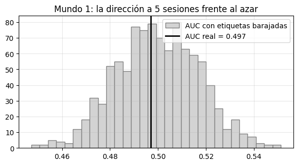 | 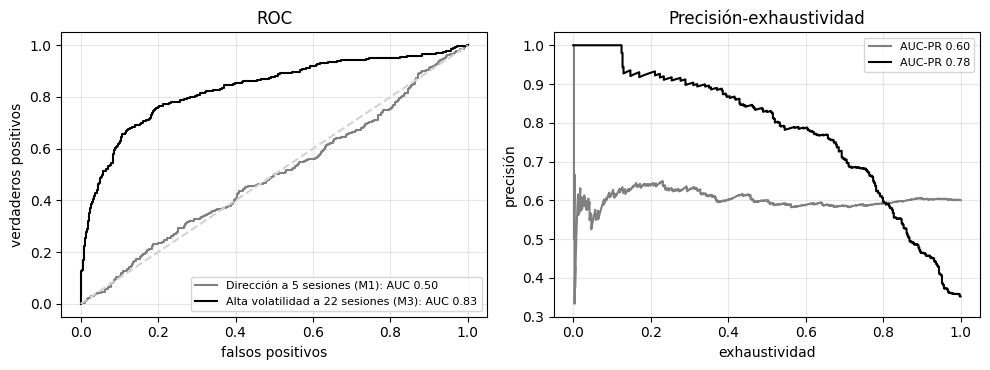 |
| *G1 · El AUC real de la dirección (0,497) cae dentro de la distribución del azar.* | *G1 · Mismo código, otro objetivo: AUC 0,50 frente a 0,83.* |
| 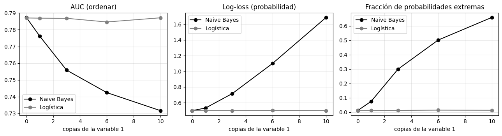 | 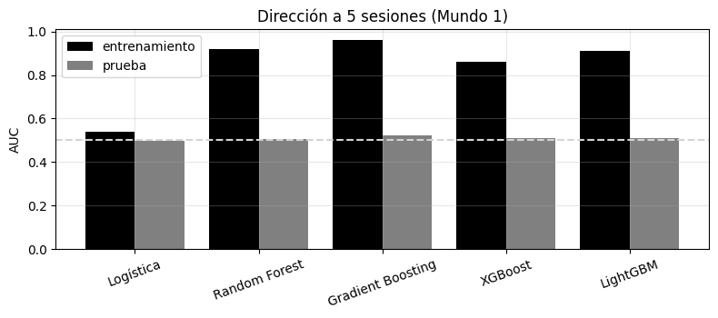 |
| *G2 · Con copias de una variable, Naive Bayes sobreconfía (log-loss ×3).* | *G3 · Los ensambles memorizan el ruido: AUC de entrenamiento 0,86–0,96, de prueba 0,50–0,52.* |
| 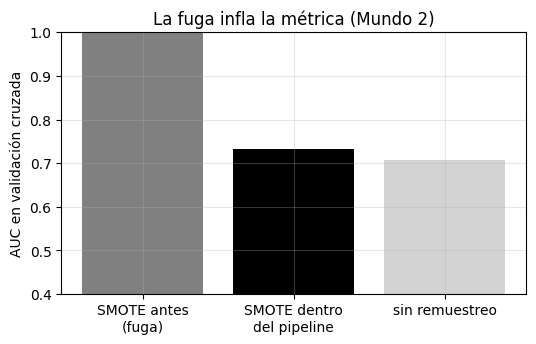 | 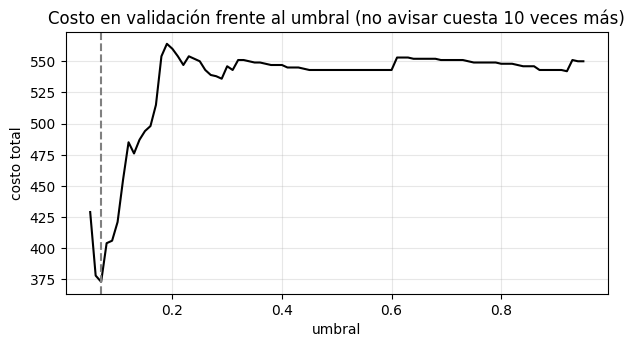 |
| *G4 · SMOTE antes de dividir infla el AUC (0,998 frente a 0,733).* | *G4 · El umbral sale del cociente de costos y se elige en validación.* |
| 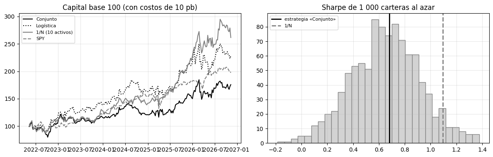 | |
| *G5 · La cartera top-3 queda a media distribución de las carteras al azar y bajo 1/N.* | |

## Datos de respaldo

Cada notebook usa **primero** los cuatro CSV de esta carpeta si están junto al notebook (las cifras coinciden entonces con las de las guías); si no están, descarga los precios con `yfinance` (las cifras pueden moverse en centésimas si Yahoo revisó precios históricos). Los CSV ya están en `notebooks/`:

| Archivo | Contenido | Lo usan |
|---|---|---|
| `26.11.20.cierres_ajustados_28_activos_2010-01-04_2026-11-19.csv` | Cierres ajustados de 28 activos (índices, ETF sectoriales, acciones, mineras y VIX), 2010-01-04 a 2026-11-19 | Guías 1 a 5 |
| `26.11.20.altos_ajustados_28_activos_2010-01-04_2026-11-19.csv` | Máximos diarios ajustados | Guías 1 a 5 |
| `26.11.20.bajos_ajustados_28_activos_2010-01-04_2026-11-19.csv` | Mínimos diarios ajustados | Guías 1 a 5 |
| `26.11.20.volumenes_28_activos_2010-01-04_2026-11-19.csv` | Volúmenes | Guías 1 a 5 |

Los datos provienen de Yahoo Finance y se incluyen solo con fines educativos y de reproducibilidad. **No** están cubiertos por la licencia de este repositorio: los términos de uso de Yahoo rigen su redistribución.

## Tablero y servidor (`tablero/`)

La Guía 5 escribe `dashboard_clasificacion.json` y `recomendaciones_5_sesiones.csv` en la carpeta donde se ejecuta. La carpeta `tablero/` guarda una copia de muestra, generada el 20-nov-2026 con el cierre del 19-nov, para verla sin ejecutar nada:

| Archivo | Qué es |
|---|---|
| [`08_Tablero_Clasificacion.html`](tablero/08_Tablero_Clasificacion.html) | Tablero de un solo archivo con los datos incrustados: semáforo de mercado, tabla de señales, curva de capital y métricas del backtest. **No requiere Internet** (gráfico en canvas) y sigue prácticas de accesibilidad (texto en las señales, tablas con encabezados, foco visible). Se abre con doble clic; permite cargar otro JSON. |
| [`servidor_flask_tablero.py`](tablero/servidor_flask_tablero.py) | Servidor Flask mínimo: `/` sirve el tablero, `/api/dashboard` el JSON y `/api/recomendaciones` solo las señales. |
| [`dashboard_clasificacion.json`](tablero/dashboard_clasificacion.json) | Datos que lee el servidor (salida de la Guía 5). |
| [`recomendaciones_5_sesiones.csv`](tablero/recomendaciones_5_sesiones.csv) | Probabilidades por activo y señal. |

```bash
cd tablero
python servidor_flask_tablero.py     # abrir http://127.0.0.1:5013
```

## Diagramas UML (`diagramas/` y `diagramas_misiones/`)

Nueve diagramas escritos en [PlantUML](https://plantuml.com/) (`.puml`) y renderizados a imagen (`.png`): cinco del sistema completo y cuatro de las misiones del trabajo grupal. Cada diagrama tiene su miniatura en `diagramas/miniaturas/` (los PNG originales son grandes y en GitHub se amplían al abrirlos).

| Diagrama | Qué muestra | Imagen | Código |
|---|---|---|---|
| Componentes | Fuentes, preparación, modelado, evaluación, sistema de recomendaciones y despliegue | [PNG](diagramas/26.11.20.T13_UML_01_Componentes.png) | [`.puml`](diagramas/26.11.20.T13_UML_01_Componentes.puml) |
| Secuencia | Cómo se produce la recomendación semanal de la Guía 5 | [PNG](diagramas/26.11.20.T13_UML_02_Secuencia.png) | [`.puml`](diagramas/26.11.20.T13_UML_02_Secuencia.puml) |
| Clases | Datos, modelos, evaluación y sistema | [PNG](diagramas/26.11.20.T13_UML_03_Clases.png) | [`.puml`](diagramas/26.11.20.T13_UML_03_Clases.puml) |
| Actividades | Del precio a la recomendación semanal | [PNG](diagramas/26.11.20.T13_UML_04_Actividades.png) | [`.puml`](diagramas/26.11.20.T13_UML_04_Actividades.puml) |
| Casos de uso | Estudiante, docente, gestor y Yahoo Finance | [PNG](diagramas/26.11.20.T13_UML_05_Casos_de_Uso.png) | [`.puml`](diagramas/26.11.20.T13_UML_05_Casos_de_Uso.puml) |
| Misión 1 · Actividades | Dirección de los activos del grupo y pruebas múltiples | [PNG](diagramas_misiones/26.11.20.M1_UML_Actividades.png) | [`.puml`](diagramas_misiones/26.11.20.M1_UML_Actividades.puml) |
| Misión 2 · Componentes | Contraste sintético de desbalance | [PNG](diagramas_misiones/26.11.20.M2_UML_Componentes.png) | [`.puml`](diagramas_misiones/26.11.20.M2_UML_Componentes.puml) |
| Misión 3 · Secuencia | Alta volatilidad y alerta de caída de un activo | [PNG](diagramas_misiones/26.11.20.M3_UML_Secuencia.png) | [`.puml`](diagramas_misiones/26.11.20.M3_UML_Secuencia.puml) |
| Misión 4 · Clases | Sistema de recomendaciones del portafolio | [PNG](diagramas_misiones/26.11.20.M4_UML_Clases.png) | [`.puml`](diagramas_misiones/26.11.20.M4_UML_Clases.puml) |

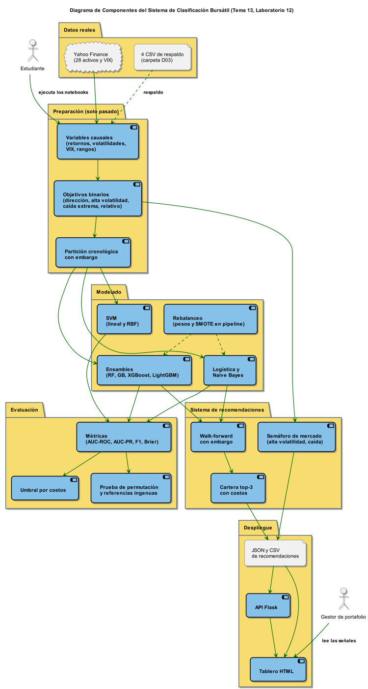

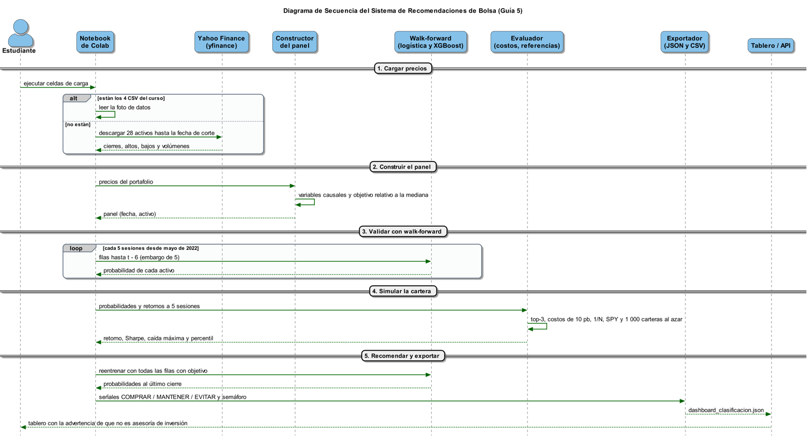

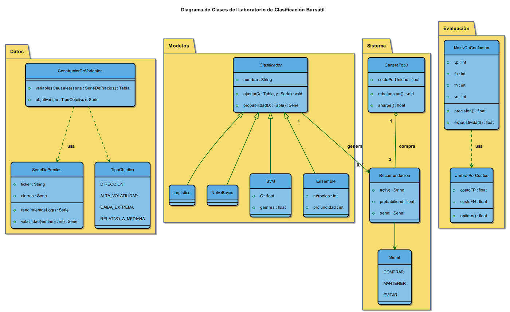

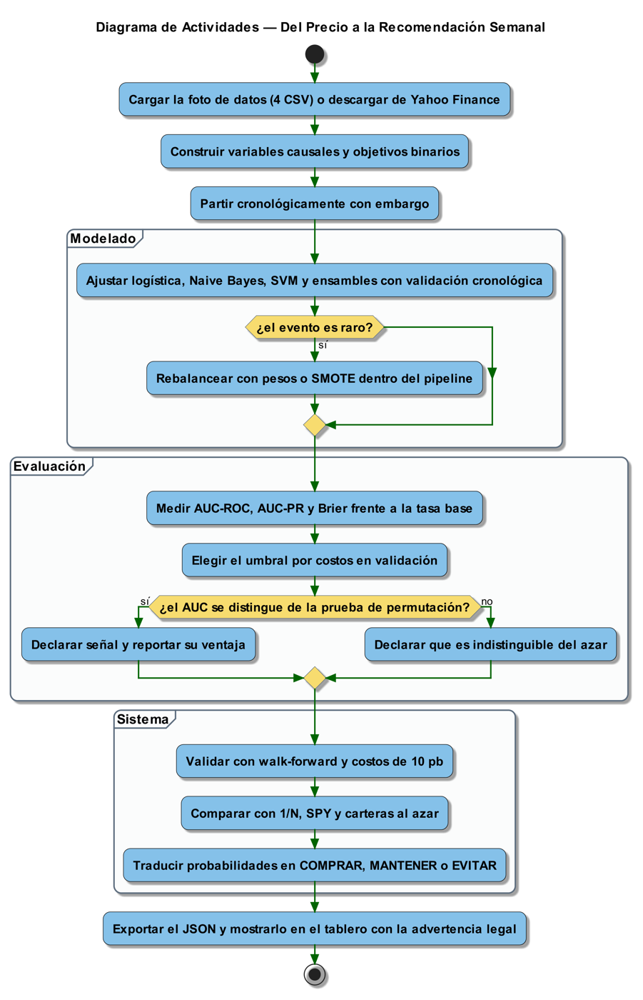

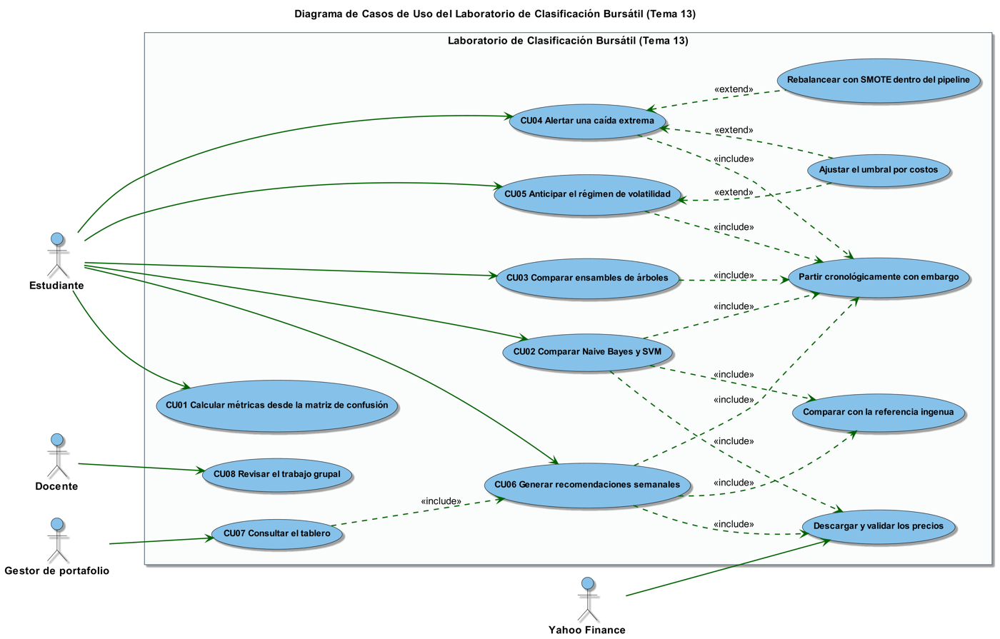

Para regenerarlos desde el código: `plantuml -tpng diagramas/*.puml diagramas_misiones/*.puml`.

## Scripts del trabajo grupal (`scripts_grupales/`)

Cuatro scripts parametrizados por los tickers del grupo, con una misión cada uno (los tres mundos): `m1_direccion_portafolio_prueba_de_azar.py`, `m2_contraste_desbalance_sintetico.py`, `m3_competencia_alta_volatilidad_y_alerta.py` y `m4_sistema_recomendaciones_portafolio.py` (más `comun_m13.py`). Usan los mismos cuatro CSV; cópielos a la carpeta del script:

```bash
cd scripts_grupales
cp ../notebooks/*.csv .
python m3_competencia_alta_volatilidad_y_alerta.py QQQ
python m4_sistema_recomendaciones_portafolio.py BVN,FSM,SCCO,BHP,B,AAPL,JPM,XOM,KO,PFE
```

Cada script imprime sus tablas y escribe sus salidas (`m*_resultados_*.csv`, `dashboard_clasificacion.json`, figuras) en esa carpeta; todo eso está en `.gitignore`.

## Cómo ejecutarlos

```bash
git clone https://github.com/mbaernestocr-tech/clasificacion-bursatil-dm-lab12.git
cd clasificacion-bursatil-dm-lab12
python -m venv .venv && source .venv/bin/activate      # en Windows: .venv\Scripts\activate
pip install -r requirements.txt
cd notebooks
jupyter lab
```

En Google Colab: abra el notebook con el botón de la tabla, instale las librerías que falten y, si desea usar la foto de datos, suba también los cuatro CSV al entorno.

## Entorno con el que se ejecutaron

Python 3.10 · scikit-learn 1.3.1 · imbalanced-learn 0.12.4 · XGBoost 3.2.0 (con `n_jobs=1` para resultados repetibles) · LightGBM 4.5.0 · pandas 2.2.3 · numpy 1.26.4 · yfinance 1.2.0, en Windows con CPU, el 20-nov-2026, con la foto de datos del cierre del 19-nov-2026. No se ejecutaron en Google Colab.

Nota: en Windows, LightGBM 4.7.0 junto con XGBoost 3.2.0 puede cerrar Python con «access violation»; se usó LightGBM 4.5.0.

## Estructura del repositorio

```text
clasificacion-bursatil-dm-lab12/
├── notebooks/            5 notebooks ejecutados + 4 CSV de respaldo
├── figuras/              7 figuras destacadas producidas por los notebooks
├── diagramas/            5 UML del sistema (.puml y .png) + miniaturas/
├── diagramas_misiones/   4 UML de las misiones del trabajo grupal (.puml y .png)
├── tablero/              tablero HTML sin Internet, servidor Flask, JSON y CSV de muestra
├── scripts_grupales/     4 scripts de misiones + comun_m13.py
├── requirements.txt
├── CITATION.cff
└── LICENSE
```

## Alcance y advertencias

- Material **educativo**. Nada de lo que contiene es asesoría de inversión; las señales COMPRAR / MANTENER / EVITAR ilustran una técnica, y el propio sistema muestra que la selección de activos no se distingue del azar.
- Las cifras de los notebooks vienen de datos reales descargados el 20-nov-2026; con una descarga nueva pueden moverse levemente.
- Un resultado sobre datos sintéticos demuestra un mecanismo, no un hecho del mercado; los notebooks indican en cada caso qué datos usan.
- Parte del código y de los textos se elaboró con asistencia de IA generativa (Claude, de Anthropic), y el autor revisó el contenido y responde por él.

## Cómo citar y licencia

Use el botón «Cite this repository» de GitHub (archivo [`CITATION.cff`](CITATION.cff)).

© 2026 Ernesto D. Cancho-Rodríguez. Notebooks, código, diagramas y textos bajo [Creative Commons Atribución 4.0 Internacional (CC BY 4.0)](https://creativecommons.org/licenses/by/4.0/); el texto legal está en [`LICENSE`](LICENSE). Los datos de Yahoo Finance quedan fuera de esta licencia, como se explica arriba.
